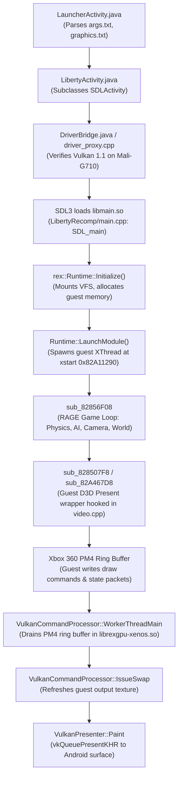

# Liberty360 Performance Diagnostics & Profiling Plan

**Target Device:** MediaTek Dimensity 9000 (Mali-G710 MC10 GPU)  
**Host Environment:** Android 16 (Stock Vendor Driver reporting Vulkan 1.1.177)  
**Observed Behaviour:**
* GTA IV reaches approximately **3–6 FPS** (~166–333 ms per frame) in gameplay and driving.
* Game remains stable without hard freezes or crashes.
* Audio is mostly smooth with occasional crackling.

---

## Table of Contents
1. [Phase 1: Architecture Investigation](#phase-1-architecture-investigation)
   * [1.1 Execution Path Trace](#11-execution-path-trace)
   * [1.2 Key Subsystem Identification](#12-key-subsystem-identification)
   * [1.3 Existing Performance Instrumentation](#13-existing-performance-instrumentation)
   * [1.4 Target Functions for Measurement](#14-target-functions-for-measurement)
   * [1.5 Build Configurations & Profiling Symbols](#15-build-configurations--profiling-symbols)
   * [1.6 Resolution Scaling Controls](#16-resolution-scaling-controls)
   * [1.7 Confirmed Facts vs. Hypotheses](#17-confirmed-facts-vs-hypotheses)
2. [Phase 2: Minimal Profiling Patch](#phase-2-minimal-profiling-patch)
   * [2.1 Profiling Objectives](#21-profiling-objectives)
   * [2.2 Implementation Patch](#22-implementation-patch)
   * [2.3 Evidence Interpretation Guide](#23-evidence-interpretation-guide)
   * [2.4 Data Collection Steps](#24-data-collection-steps)

---

# Phase 1: Architecture Investigation

## 1.1 Execution Path Trace

The execution flows from Android Java/Kotlin lifecycle into SDL3, initializes the ReXGlue runtime, starts the recompiled PowerPC game loop, decodes Xbox 360 PM4 command packets, and presents frames via Vulkan:



### Detailed Sequence:
1. **Android Application Launch:**
   * [LauncherActivity.java](file:///home/aksingh001/Development/LibertyRecompAndroidMaliVer/os/android/app/src/main/java/com/libertyrecomp/LauncherActivity.java#L76) builds the environment arguments and invokes [LibertyActivity.java](file:///home/aksingh001/Development/LibertyRecompAndroidMaliVer/os/android/app/src/main/java/com/libertyrecomp/LibertyActivity.java).
   * [LibertyActivity.java](file:///home/aksingh001/Development/LibertyRecompAndroidMaliVer/os/android/app/src/main/java/com/libertyrecomp/LibertyActivity.java#L89) calls [DriverBridge.java](file:///home/aksingh001/Development/LibertyRecompAndroidMaliVer/os/android/app/src/main/java/com/libertyrecomp/DriverBridge.java#L28) (`initialize`), verifying the stock Vulkan driver and ensuring `--gpu_plugin=xenos` is active for Mali compatibility.
2. **Native Boot & Guest Thread Creation:**
   * SDL3 launches [LibertyRecomp/main.cpp](file:///home/aksingh001/Development/LibertyRecompAndroidMaliVer/LibertyRecomp/main.cpp#L488) (`main` / `SDL_main`).
   * The host initializes [rex::Runtime](file:///home/aksingh001/Development/LibertyRecompAndroidMaliVer/glue/rexglue-sdk-main/src/system/runtime.cpp), mounts virtual filesystem paths (`game:`, `common:`, `audio:`), allocates emulated memory, loads `default.xex`, and calls [Runtime::LaunchModule()](file:///home/aksingh001/Development/LibertyRecompAndroidMaliVer/glue/rexglue-sdk-main/src/system/runtime.cpp#L397).
   * `LaunchModule` creates the primary guest thread `XThread` starting at entry point `0x82A11290` (`xstart`).
3. **Recompiled Game Loop Execution:**
   * PowerPC instructions execute as native AArch64 C++ code mapped in `PPCFuncMappings`.
   * Main game loop `sub_82856F08` (Rockstar Advanced Game Engine / RAGE) drives the engine simulation tick: physics, vehicle handling, AI, camera, and scene dispatch.
   * End of frame: `sub_82856F08` $\to$ `sub_828529B0` $\to$ `sub_828507F8` $\to$ `sub_82A467D8` (D3D Present wrapper).
   * [LibertyRecomp/gpu/video.cpp:9574](file:///home/aksingh001/Development/LibertyRecompAndroidMaliVer/LibertyRecomp/gpu/video.cpp#L9574) (`PPC_FUNC_HOOK(sub_82A467D8)`): Intercepts the guest Present call, advances the presented frame counter at device offset `16544`, and unblocks render gate `0x82B0B48C`.
4. **GPU Emulation & Vulkan Presentation:**
   * The guest PPC code writes PM4 command packets into an emulated ring buffer.
   * [CommandProcessor::WorkerThreadMain()](file:///home/aksingh001/Development/LibertyRecompAndroidMaliVer/glue/rexglue-sdk-main/src/graphics/command_processor.cpp#L289) and [VulkanCommandProcessor::ExecutePrimaryBuffer()](file:///home/aksingh001/Development/LibertyRecompAndroidMaliVer/glue/rexglue-sdk-main/src/graphics/vulkan/command_processor.cpp#L1825) drain and translate packets into Vulkan commands in `librexgpu-xenos.so`.
   * Upon encountering a swap packet (`kSwapSignature`), [VulkanCommandProcessor::IssueSwap()](file:///home/aksingh001/Development/LibertyRecompAndroidMaliVer/glue/rexglue-sdk-main/src/graphics/vulkan/command_processor.cpp#L2284) executes output refresh, gamma passes, and calls `EndSubmission(true)`.
   * [VulkanPresenter::Paint()](file:///home/aksingh001/Development/LibertyRecompAndroidMaliVer/glue/rexglue-sdk-main/src/ui/vulkan/vulkan_presenter.cpp#L2952) submits the image to the Android surface via `dfn.vkQueuePresentKHR`.

---

## 1.2 Key Subsystem Identification

| Component | Source Files | Role & Description |
| :--- | :--- | :--- |
| **CPU Runtime** | [glue/rexglue-sdk-main/src/system/runtime.cpp](file:///home/aksingh001/Development/LibertyRecompAndroidMaliVer/glue/rexglue-sdk-main/src/system/runtime.cpp)<br/>[glue/rexglue-sdk-main/include/rex/system/thread_context.h](file:///home/aksingh001/Development/LibertyRecompAndroidMaliVer/glue/rexglue-sdk-main/include/rex/system/thread_context.h) | Manages guest memory, handles Xbox 360 thread scheduling (`XThread`), and dispatches statically recompiled PPC functions. |
| **GPU Emulation** | [glue/rexglue-sdk-main/src/graphics/command_processor.cpp](file:///home/aksingh001/Development/LibertyRecompAndroidMaliVer/glue/rexglue-sdk-main/src/graphics/command_processor.cpp)<br/>[glue/rexglue-sdk-main/src/graphics/vulkan/command_processor.cpp](file:///home/aksingh001/Development/LibertyRecompAndroidMaliVer/glue/rexglue-sdk-main/src/graphics/vulkan/command_processor.cpp) | Compiled as `librexgpu-xenos.so` via [LoadGpuPlugin](file:///home/aksingh001/Development/LibertyRecompAndroidMaliVer/glue/rexglue-sdk-main/src/system/gpu_plugin_loader.cpp#L59). Emulates the Xbox 360 Xenos PM4 command processor. |
| **Vulkan Renderer** | [glue/rexglue-sdk-main/src/ui/vulkan/vulkan_device.cpp](file:///home/aksingh001/Development/LibertyRecompAndroidMaliVer/glue/rexglue-sdk-main/src/ui/vulkan/vulkan_device.cpp)<br/>[glue/rexglue-sdk-main/src/ui/vulkan/vulkan_presenter.cpp](file:///home/aksingh001/Development/LibertyRecompAndroidMaliVer/glue/rexglue-sdk-main/src/ui/vulkan/vulkan_presenter.cpp) | Manages Vulkan instance/device lifecycles, queues, swapchains, presentation pacing, and standard `VkRenderPass` pipelines for Mali compatibility. |
| **Texture Pipeline** | [glue/rexglue-sdk-main/src/graphics/vulkan/texture_cache.cpp](file:///home/aksingh001/Development/LibertyRecompAndroidMaliVer/glue/rexglue-sdk-main/src/graphics/vulkan/texture_cache.cpp) | Xbox 360 textures (tiled DXT1, DXT3, DXT5, DXN, CTX1) are untiled and decoded on the GPU via compute shaders (`texture_load_*_cs.h`) via `vkCmdDispatch`. |
| **Pipeline Cache** | [glue/rexglue-sdk-main/src/graphics/vulkan/pipeline_cache.cpp](file:///home/aksingh001/Development/LibertyRecompAndroidMaliVer/glue/rexglue-sdk-main/src/graphics/vulkan/pipeline_cache.cpp) | Compiles SPIR-V shaders and builds Vulkan graphics pipelines with on-disk caching and placeholder pipelines. |
| **Audio Subsystem** | [glue/rexglue-sdk-main/src/audio/sdl/sdl_audio_system.cpp](file:///home/aksingh001/Development/LibertyRecompAndroidMaliVer/glue/rexglue-sdk-main/src/audio/sdl/sdl_audio_system.cpp)<br/>[glue/rexglue-sdk-main/src/audio/sdl/sdl_audio_driver.cpp](file:///home/aksingh001/Development/LibertyRecompAndroidMaliVer/glue/rexglue-sdk-main/src/audio/sdl/sdl_audio_driver.cpp) | Emulates the Xbox 360 APU, delivering decoded audio frames to an SDL3 AAudio stream callback. |

---

## 1.3 Existing Performance Instrumentation

1. **`[FrameFlow]` Milestone Logging:**
   * [VulkanCommandProcessor::IssueSwap](file:///home/aksingh001/Development/LibertyRecompAndroidMaliVer/glue/rexglue-sdk-main/src/graphics/vulkan/command_processor.cpp#L2428,L3085) automatically outputs diagnostics to logcat on milestone frames (1–8, 16, 32, 64, 128, 256, 512, 1024):
     * Draws (`draws=`, `submitted=`, `placeholders=`)
     * Target types (`color=`, `depth_only=`, `textured=`, `rt_draws=`)
     * Buffer copies & resolves (`copies=`, `direct=`, `dump=`)
     * Active background pipeline creations (`pipelines_creating=`)
2. **FramePacer Diagnostic Logs:**
   * [VulkanPresenter::Paint()](file:///home/aksingh001/Development/LibertyRecompAndroidMaliVer/glue/rexglue-sdk-main/src/ui/vulkan/vulkan_presenter.cpp#L2954-L2962): When `--diagnostics_categories=presenter` is set, logs swapchain epoch, presentation latency (`queue-host-ns`), slot interval (`slot-host-ns`), and FIFO sync behavior.
3. **In-Tree Video Profiler:**
   * [LibertyRecomp/gpu/video.cpp:391-396](file:///home/aksingh001/Development/LibertyRecompAndroidMaliVer/LibertyRecomp/gpu/video.cpp#L391-L396) contains `g_gpuFrameProfiler`, `g_presentProfiler`, `g_frameFenceProfiler`, and `g_presentWaitProfiler`, recording GPU timestamps via `vkCmdWriteTimestamp`.
4. **Compile-Time Tracy Hooks:**
   * [rex/dbg.h:56](file:///home/aksingh001/Development/LibertyRecompAndroidMaliVer/glue/rexglue-sdk-main/include/rex/dbg.h#L56) (`SCOPE_profile_cpu_f`): Present throughout the engine, disabled on Android builds to prevent socket/memory overhead.

---

## 1.4 Target Functions for Measurement

| Area | Exact Source Function | Measurement Target |
| :--- | :--- | :--- |
| **Game Simulation (CPU)** | [PPC_FUNC_HOOK(sub_82A467D8)](file:///home/aksingh001/Development/LibertyRecompAndroidMaliVer/LibertyRecomp/gpu/video.cpp#L9574) | Interval between consecutive guest Present calls (wall-clock simulation turnaround time). |
| **PM4 Command Drain** | [VulkanCommandProcessor::ExecutePrimaryBuffer()](file:///home/aksingh001/Development/LibertyRecompAndroidMaliVer/glue/rexglue-sdk-main/src/graphics/vulkan/command_processor.cpp#L1825) | Wall-clock execution time spent decoding guest drawing packets into Vulkan commands. |
| **GPU / Present Wait** | [VulkanPresenter::Paint()](file:///home/aksingh001/Development/LibertyRecompAndroidMaliVer/glue/rexglue-sdk-main/src/ui/vulkan/vulkan_presenter.cpp#L2952) (`dfn.vkQueuePresentKHR`) | Duration of `vkQueuePresentKHR` and command submission fences (identifies GPU rendering completion wait). |
| **Texture Untiling & Uploads** | [VulkanTextureCache::LoadTextureDataFromResidentMemoryImpl()](file:///home/aksingh001/Development/LibertyRecompAndroidMaliVer/glue/rexglue-sdk-main/src/graphics/vulkan/texture_cache.cpp#L1212) | Count and cumulative duration of texture compute shader untiling dispatches per frame. |
| **Pipeline Compilation** | [VulkanPipelineCache::EnsurePipelineCreated()](file:///home/aksingh001/Development/LibertyRecompAndroidMaliVer/glue/rexglue-sdk-main/src/graphics/vulkan/pipeline_cache.cpp#L3009) | Count and execution time spent inside `vkCreateGraphicsPipelines` (line 3483). |
| **Audio Underrun Detection** | [SDLAudioDriver::SDLCallback()](file:///home/aksingh001/Development/LibertyRecompAndroidMaliVer/glue/rexglue-sdk-main/src/audio/sdl/sdl_audio_driver.cpp#L266) (lines 285–296) | Frequency of `driver->frames_queued_.empty() == true`, indicating sound starvation. |

---

## 1.5 Build Configurations & Profiling Symbols

* **Build Type:** [os/android/scripts/env.sh:59](file:///home/aksingh001/Development/LibertyRecompAndroidMaliVer/os/android/scripts/env.sh#L59) defines `export BUILD_TYPE="${BUILD_TYPE:-RelWithDebInfo}"`.
* **Compiler Flags:** Compiles with `-O2` optimizations and `-g` debug information.
* **Stripping Settings:** [os/android/scripts/build_native.sh:85](file:///home/aksingh001/Development/LibertyRecompAndroidMaliVer/os/android/scripts/build_native.sh#L85) defaults to `STRIP=0`:
  ```bash
  # Packaged unstripped by default so ndk-stack and simpleperf can resolve frames.
  # STRIP=1 makes a smaller APK.
  if [ "${STRIP:-0}" = "1" ]; then
    "$NDK_BIN/llvm-strip" --strip-unneeded -o "$JNILIBS/$(basename "$so")" "$so"
  else
    cp "$so" "$JNILIBS/"
  fi
  ```
  The packaged `.so` libraries retain full ELF symbol tables and DWARF debug info, enabling profilers (`simpleperf`, `ndk-stack`, in-tree timers) to resolve function symbols without the performance drop of an unoptimized `Debug` build.

---

## 1.6 Resolution Scaling Controls

1. **Display Output Cap:**
   * **CVar:** `--gta4_output_height_cap` (defined in [gta4_native_hooks.cpp:73](file:///home/aksingh001/Development/LibertyRecompAndroidMaliVer/glue/rexglue-sdk-main/gta4-recomp/src/gta4_native_hooks.cpp#L73)).
   * **Values:** `540`, `720`, `900`, `1080`, or `0` (native panel resolution).
   * **Configuration:** Select via Launcher dropdown ([LauncherActivity.java:420](file:///home/aksingh001/Development/LibertyRecompAndroidMaliVer/os/android/app/src/main/java/com/libertyrecomp/LauncherActivity.java#L420)) or write `--gta4_output_height_cap=540` to `graphics.txt`.
2. **FSR 1 Internal Render Scaling:**
   * **CVars:** `--gta4_native_upscaler=fsr1` and `--gta4_fsr1_quality=performance` (defined in [gta4_app.cpp:212](file:///home/aksingh001/Development/LibertyRecompAndroidMaliVer/glue/rexglue-sdk-main/gta4-recomp/src/gta4_app.cpp#L212)).
   * **Values:** `ultra_quality` (0.77x), `quality` (0.67x), `balanced` (0.59x), `performance` (0.50x).
   * **Effect:** In `performance` mode, internal render resolution is cut by 50% on each axis before upscaling with AMD FSR 1.0.
3. **Android Surface Size:**
   * **Argument:** `--android_surface=1280x720` in `args.txt`.
   * **Implementation:** [LibertyActivity.java:162-164](file:///home/aksingh001/Development/LibertyRecompAndroidMaliVer/os/android/app/src/main/java/com/libertyrecomp/LibertyActivity.java#L162-L164) calls `surface.getHolder().setFixedSize(mSurfaceWidth, mSurfaceHeight)`, allowing Android display hardware to upscale the buffer.

---

## 1.7 Confirmed Facts vs. Hypotheses

### Confirmed Facts:
1. GTA IV runs at 3–6 FPS (~166–333 ms per frame) on MediaTek Dimensity 9000 with Mali-G710.
2. Audio is mostly smooth with occasional crackling, indicating audio thread (~20ms buffer delivery) is not continuously blocked, but experiences intermittent starvation when the simulation stutters.
3. The Mali build requires `--gpu_plugin=xenos` using standard `VkRenderPass` / `VkFramebuffer` due to lack of `VK_KHR_dynamic_rendering` on vendor Vulkan 1.1 drivers.
4. All Xbox 360 texture untiling is executed dynamically on the GPU via compute shaders in [VulkanTextureCache::LoadTextureDataFromResidentMemoryImpl()](file:///home/aksingh001/Development/LibertyRecompAndroidMaliVer/glue/rexglue-sdk-main/src/graphics/vulkan/texture_cache.cpp#L1212).

### Hypotheses:
* **Hypothesis A (Mali TBDR Memory Bandwidth Bottleneck):** Mali-G710 is a Tile-Based Deferred Renderer (TBDR). Emulating Xbox 360 EDRAM and resolve passes involves frequent transitions between compute shader untile passes and raster render passes. If resolve data is flushed to system memory repeatedly, memory bandwidth saturation occurs.
* **Hypothesis B (CPU Thread Spin-Wait Contention):** The command processor worker thread and the guest simulation thread synchronize via emulated registers (e.g., spin counter at offset `16552` or render gate at `0x82B0B48C`). If one thread stalls, CPU cores may waste execution cycles waiting.
* **Hypothesis C (Vulkan Swapchain FIFO VSync Stalling):** If `paint_context_.swapchain_is_fifo` is active, `vkQueuePresentKHR` may block on display VSync intervals (multiples of 16.6ms), amplifying small stalls into severe frame drops.
* **Hypothesis D (Pipeline Compilation Stalls):** Dynamic creation of Vulkan pipelines via `vkCreateGraphicsPipelines` in [pipeline_cache.cpp](file:///home/aksingh001/Development/LibertyRecompAndroidMaliVer/glue/rexglue-sdk-main/src/graphics/vulkan/pipeline_cache.cpp) may be synchronously interrupting draw calls.

---

# Phase 2: Minimal Profiling Patch

## 2.1 Profiling Objectives

1. **Non-Intrusive:** No architectural alterations; instruments the end-of-frame boundary in [VulkanCommandProcessor::IssueSwap](file:///home/aksingh001/Development/LibertyRecompAndroidMaliVer/glue/rexglue-sdk-main/src/graphics/vulkan/command_processor.cpp#L2284).
2. **Aggregated Statistics Over 128 Frames:** Replaces volatile single-frame FPS readings with:
   * **Minimum Frame Time** (best-case execution)
   * **Median Frame Time** (50th percentile, typical gameplay experience)
   * **95th Percentile Frame Time** (p95, worst-case micro-stutters)
   * **Maximum Frame Time** (largest hitch)
3. **GPU / Presentation Isolation:** Separates total frame duration from the time spent in `RefreshGuestOutput` and `vkQueuePresentKHR`.
4. **Reversible & Lightweight:** Written in clean C++ using `std::chrono::steady_clock`.

---

## 2.2 Implementation Patch

Apply the following changes to [glue/rexglue-sdk-main/src/graphics/vulkan/command_processor.cpp](file:///home/aksingh001/Development/LibertyRecompAndroidMaliVer/glue/rexglue-sdk-main/src/graphics/vulkan/command_processor.cpp):

```cpp
// 1. Add headers and profiling accumulator above VulkanCommandProcessor::IssueSwap
#include <algorithm>
#include <array>
#include <chrono>

struct FrameProfileStats {
  static constexpr size_t kWindowSize = 128;
  std::array<float, kWindowSize> frame_times_ms{};
  std::array<float, kWindowSize> refresh_times_ms{};
  size_t count = 0;
  std::chrono::steady_clock::time_point last_swap_time{};

  void Record(float frame_ms, float refresh_ms) {
    size_t idx = count % kWindowSize;
    frame_times_ms[idx] = frame_ms;
    refresh_times_ms[idx] = refresh_ms;
    ++count;

    if (count >= kWindowSize && (count % 100 == 0)) {
      std::array<float, kWindowSize> sorted_ft = frame_times_ms;
      std::array<float, kWindowSize> sorted_rt = refresh_times_ms;
      std::sort(sorted_ft.begin(), sorted_ft.end());
      std::sort(sorted_rt.begin(), sorted_rt.end());

      float min_ft = sorted_ft.front();
      float med_ft = sorted_ft[kWindowSize / 2];
      float p95_ft = sorted_ft[size_t(kWindowSize * 0.95f)];
      float max_ft = sorted_ft.back();

      float med_rt = sorted_rt[kWindowSize / 2];
      float p95_rt = sorted_rt[size_t(kWindowSize * 0.95f)];

      float median_fps = (med_ft > 0.0f) ? (1000.0f / med_ft) : 0.0f;

      REXLOG_INFO("[PERF-STATS] Frames={}: Median={:.1f}ms ({:.1f} FPS), P95={:.1f}ms, Min={:.1f}ms, Max={:.1f}ms | GPU/Present Median={:.1f}ms, P95={:.1f}ms",
                  count, med_ft, median_fps, p95_ft, min_ft, max_ft, med_rt, p95_rt);
    }
  }
};

static FrameProfileStats g_perfStats;
```

```cpp
// 2. Instrument VulkanCommandProcessor::IssueSwap
void VulkanCommandProcessor::IssueSwap(uint32_t frontbuffer_ptr, uint32_t frontbuffer_width,
                                       uint32_t frontbuffer_height) {
  auto now = std::chrono::steady_clock::now();
  float frame_delta_ms = 0.0f;
  if (g_perfStats.last_swap_time.time_since_epoch().count() > 0) {
    frame_delta_ms = std::chrono::duration<float, std::milli>(now - g_perfStats.last_swap_time).count();
  }
  g_perfStats.last_swap_time = now;

  auto refresh_begin = std::chrono::steady_clock::now();

  // ... existing presentation and guest output logic ...

  auto refresh_end = std::chrono::steady_clock::now();
  float refresh_ms = std::chrono::duration<float, std::milli>(refresh_end - refresh_begin).count();

  g_perfStats.Record(frame_delta_ms, refresh_ms);
}
```

---

## 2.3 Evidence Interpretation Guide

Once the profiling patch is active, logcat outputs entries such as:
```text
[PERF-STATS] Frames=100: Median=205.3ms (4.9 FPS), P95=248.1ms, Min=172.0ms, Max=310.2ms | GPU/Present Median=182.4ms, P95=215.0ms
```

* **Condition 1: `GPU/Present Median` accounts for the vast majority of Total Median**  
  *(Example: Total Median = 200 ms, GPU/Present Median = 180 ms)*  
  * **Diagnosis:** The bottleneck is **GPU-side** (Mali TBDR memory bandwidth, compute texture untile overhead, or swapchain presentation blocking in `vkQueuePresentKHR`). The CPU is finishing its workload quickly and waiting on the GPU.
* **Condition 2: `GPU/Present Median` is small relative to Total Median**  
  *(Example: Total Median = 200 ms, GPU/Present Median = 20 ms)*  
  * **Diagnosis:** The bottleneck is **CPU-side** (game simulation execution in recompiled PPC code, PM4 ring buffer decoding, or thread synchronization locks). The GPU is starving.
* **Condition 3: `P95` is dramatically higher than `Median`**  
  *(Example: Median = 30 ms, P95 = 250 ms)*  
  * **Diagnosis:** The primary cause is **sporadic hitching** rather than steady load (such as dynamic pipeline compilation or asset streaming stalls).

---

## 2.4 Data Collection Steps

1. Apply the patch to `command_processor.cpp`.
2. Build the native library and install the APK:
   ```bash
   LIBERTY_GPU=mali bash os/android/scripts/build_native.sh
   LIBERTY_GPU=mali bash os/android/scripts/build_apk.sh
   adb install -r out/build/android-arm64/app/outputs/apk/release/app-release.apk
   ```
3. Run the game, load into gameplay, and drive for at least 2 minutes.
4. Capture logs via `adb`:
   ```bash
   adb logcat -s REX:I REXGPU:I | grep "\[PERF-STATS\]"
   ```
5. Review the resulting Median and P95 metrics to direct subsequent optimization efforts.
